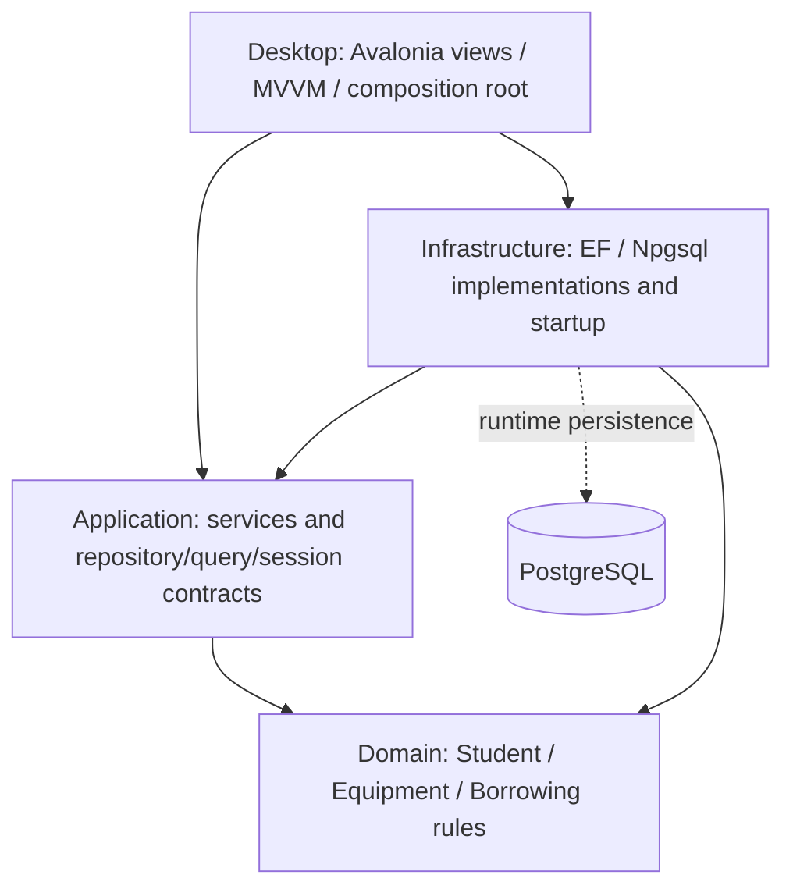
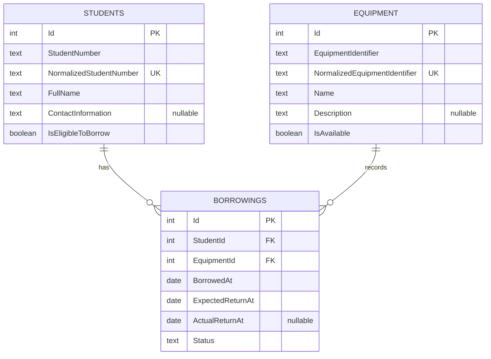

# Architecture, persistence and design decisions

## Responsibility and dependencies

Views bind commands/state to ViewModels. ViewModels invoke Application services; they contain no SQL, connection configuration or migration calls. The composition root references Infrastructure only to register implementations. Domain entities have no EF/Avalonia dependency.

Application coordinates actor goals, validation and safe operation results. Infrastructure implements database access, migrations, query projections, transaction ownership and provider-specific error classification. Startup follows MainWindowViewModel -> ApplicationStartupService -> IApplicationInitializer/PostgresBootstrapper, so database initialization does not live in a ViewModel.

## Relational model

Actual table names are Students, Equipment and Borrowings. Every borrowing requires one existing student and physical item. Generated integer identities are stable relational keys; student/equipment identifiers are editable business identifiers. Returned borrowing rows retain their IDs, links and dates. No Lab 4 hard-delete workflow is exposed.

The canonical identifier columns are PostgreSQL-generated stored values, with unique indexes. Input is trimmed in Domain; uniqueness queries also canonicalize input in PostgreSQL to match database casing. The database whitespace checks include the .NET Trim whitespace set. Required fields, nonblank values, restrictive foreign keys and date/state checks are independently enforced. A partial unique index on EquipmentId where Status = Active prevents two active loans for one item.

ExpectedReturnAt must be later than BorrowedAt. Active rows have no ActualReturnAt; Returned rows require it and cannot return before checkout. The schema does not independently enforce the three-active-item limit or synchronize the availability flag: those invariants require transactional workflow validation as well as active-item uniqueness protection.

## Context and transaction lifetime

IDbContextFactory is registered once and creates short-lived contexts. Standalone repository/query operations dispose their context after completion. A write session owns one context and serializable transaction; participating repositories share it. This avoids a root-scoped DbContext living as long as the window or being shared by overlapping asynchronous reads.

Borrowing/return and student/equipment management validate current values within their session. Checkout validates the complete selection before the first mutation; repository SaveChanges calls flush inside the shared transaction. Only CommitAsync commits. A known failure before commit leaves no partial committed changes; session disposal releases the uncommitted transaction. Serializable conflicts are reported for staff refresh/review rather than automatically replayed.

Management requests contain descriptive fields and the originally selected snapshot; a stale comparison rejects edits committed since selection. Serializable isolation also protects changes during the transaction. There is no separate row-version field, so an ABA change that returns to exactly the original values is not detected as a distinct revision.

## Dates, loading and recovery

Borrowing dates use DateOnly and the configured campus calendar (Asia/Manila by default). CampusClock converts an injected UTC time source/timezone into the local calendar date. Domain transitions receive explicit dates. Early and same-day returns are permitted; expected return must still be after checkout.

History/search queries run asynchronously with cancellation. LatestRequestGate combines advisory cancellation with a request version so a provider's late completion cannot publish stale results. Navigation invalidates outstanding reads. Empty results, missing subjects and connection failures have separate messages; unknown write outcomes require fresh reads before another staff decision.

The provider maps known serialization/deadlock/uniqueness/reference errors to safe conflicts. Transport/cancellation/timeout errors during commit and explicit unknown-resolution SQLSTATEs produce Unknown. No retry policy automatically replays writes. Actual commit-acknowledgement loss was not induced; typed mapping and injected outcome handling are covered separately from the real rollback tests.

## Migrations and seeding

Operational persistence uses Npgsql.EntityFrameworkCore.PostgreSQL 10.0.3 and EF Core 10.0.12. The repository tool manifest pins dotnet-ef 10.0.12. Runtime/design-time configuration comes from EQUIPMENT_BORROWING_CONNECTION_STRING.

InitialPostgres was authored while local scaffolding was blocked. Its frozen model is tested against the runtime model, and CI applies it to clean PostgreSQL databases with real migration history. Historical SQLite migration files are archived outside compiled discovery. Simultaneous SQLite support and historical SQLite row import are not required.

Startup applies migrations and adds examples only when each corresponding table is empty. It does not overwrite existing rows. Seeds use generated internal IDs; stable visible identifiers are STU-001..003 and EQ-101..103. Repeat startup and retained custom records are verified in the integrated lifecycle test.

## Verification limits

The [verified CI run](https://github.com/Khey3m/EquipmentBorrowing/actions/runs/43558553901) builds the complete solution with zero warnings/errors, passes 76 backend and 3 headless UI tests, and passes five separate service-process persistence stages. Full manual visual/usability and actual Avalonia Desktop close/reopen checks remain [explicitly pending](manual-verification-checklist.md).
