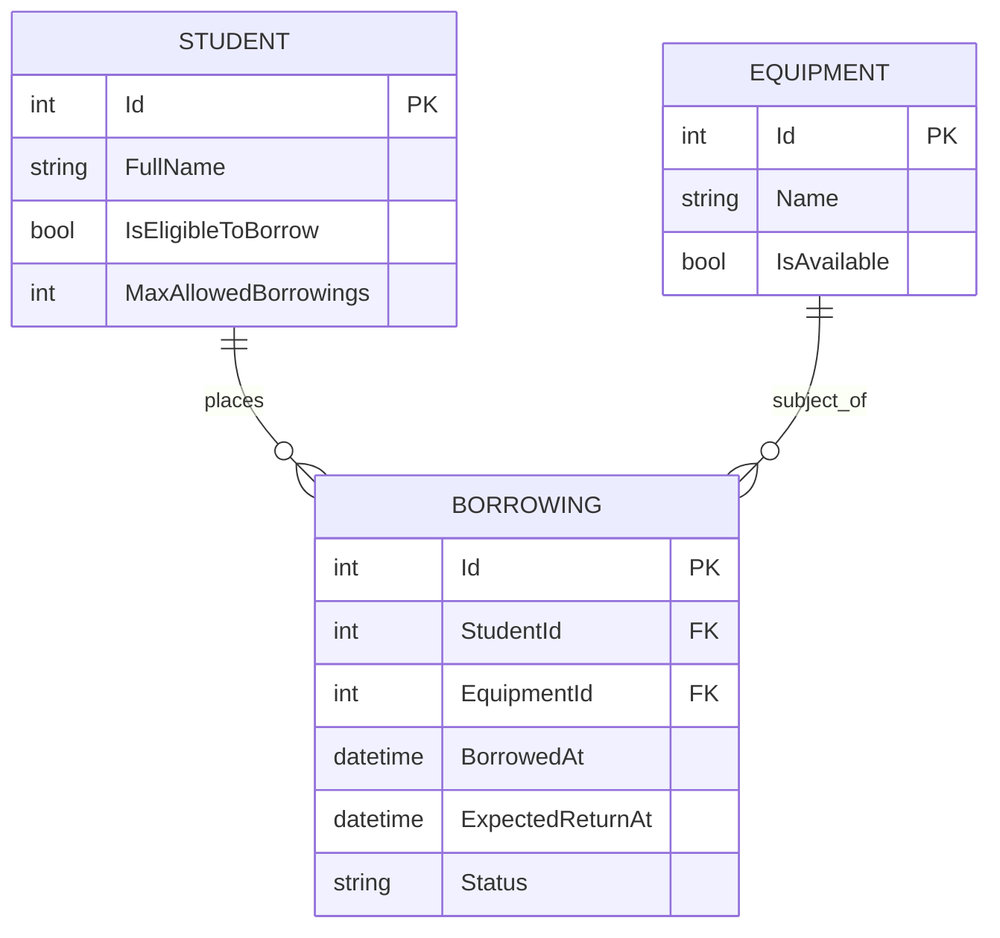

# Campus Equipment Borrowing System – Complete Development Report (Labs 1–3)

## 1. Executive Summary & System Architecture

The **Campus Equipment Borrowing System** is a multi-layered .NET desktop application designed using **Clean Architecture** and **Domain-Driven Design (DDD)** principles. Across three laboratory phases, the system evolved from an in-memory domain prototype into a full-featured Avalonia desktop application backed by persistent SQLite relational storage via Entity Framework Core.

### Layered Dependency Flow
```text
+-------------------------------------------------------------------+
| Presentation Layer (EquipmentBorrowing.Desktop)                   |
| - Avalonia AXAML Views, CommunityToolkit.Mvvm ViewModels          |
| - Composition Root (App.axaml.cs) & Dependency Injection          |
+-------------------------------------------------------------------+
                                  |
                                  v
+-------------------------------------------------------------------+
| Application Layer (EquipmentBorrowing.Application)                |
| - Use Case Services (BorrowEquipmentService, ReturnEquipmentService)|
| - Repository Interfaces (IStudentRepository, etc.)                |
+-------------------------------------------------------------------+
                                  |
                                  v
+-------------------------------------------------------------------+
| Domain Layer (EquipmentBorrowing.Domain)                          |
| - Core Entities (Student, Equipment, Borrowing)                   |
| - Value Objects & Enums (BorrowingStatus)                         |
+-------------------------------------------------------------------+
                                  ^
                                  |
+-------------------------------------------------------------------+
| Infrastructure Layer (EquipmentBorrowing.Infrastructure)          |
| - Persistence (EquipmentBorrowingDbContext, Configurations)       |
| - EF Core Repositories & Migrations (SQLite)                      |
+-------------------------------------------------------------------+
```

---

## 2. Laboratory Activity 1: Core Domain & Application Logic

### Objectives & Implementation
- **Domain Entities (`EquipmentBorrowing.Domain`)**:
  - `Student`: Tracks student identity (`Id`), `FullName`, borrowing eligibility (`IsEligibleToBorrow`), and quota limits (`MaxAllowedBorrowings`).
  - `Equipment`: Represents physical campus inventory (`Id`, `Name`) and availability state (`IsAvailable`).
  - `Borrowing`: Encapsulates lending transactions (`Id`, `StudentId`, `EquipmentId`, `BorrowedAt`, `ExpectedReturnAt`, `Status`) and state transitions via `MarkAsReturned()`.
- **Repository Abstractions (`EquipmentBorrowing.Application.Interfaces`)**:
  - Defined asynchronous contracts (`IStudentRepository`, `IEquipmentRepository`, `IBorrowingRepository`) decoupling business workflows from storage mechanisms.
- **Application Services (`EquipmentBorrowing.Application.Services`)**:
  - `BorrowEquipmentService`: Validates student eligibility, checks active borrowing quotas, verifies equipment availability, creates `Borrowing` records, and marks equipment unavailable.

---

## 3. Laboratory Activity 2: Desktop UI & MVVM Integration

### Objectives & Implementation
- **Avalonia UI & MVVM (`EquipmentBorrowing.Desktop`)**:
  - Built cross-platform AXAML views (`MainWindow.axaml`, `EquipmentView.axaml`, `BorrowingsView.axaml`) bound to reactive ViewModels (`MainWindowViewModel`, `EquipmentViewModel`, `BorrowingsViewModel`) powered by `CommunityToolkit.Mvvm`.
- **Return Workflow Extension**:
  - Implemented `ReturnEquipmentService` in the Application layer and `MarkAsReturned()` on the `Borrowing` domain entity to handle item returns and restore equipment availability.
- **Dependency Injection**:
  - Configured `Microsoft.Extensions.DependencyInjection` inside `App.axaml.cs` to resolve ViewModels, Application Services, and Repositories cleanly without tight coupling.

---

## 4. Laboratory Activity 3: Persistent Storage with SQLite & EF Core

### A. Relational Database Schema & ERD
Transitioned from volatile in-memory collections to a normalized SQLite relational database (`equipment_borrowing.db`) enforcing primary keys, foreign keys, and referential integrity.



### B. Entity Framework Core Configuration
- **DbContext (`EquipmentBorrowingDbContext`)**: Manages database sessions and auto-applies entity configurations from the assembly.
- **Design-Time Factory (`EquipmentBorrowingDbContextFactory`)**: Implements `IDesignTimeDbContextFactory<EquipmentBorrowingDbContext>` to allow `dotnet ef` CLI tools to generate migrations reliably.
- **Fluent API Configurations (`Persistence/Configurations/`)**:
  - `StudentConfiguration`, `EquipmentConfiguration`, and `BorrowingConfiguration` define primary keys, column length constraints, enum-to-string conversions (`BorrowingStatus`), and `DeleteBehavior.Restrict` foreign key relationships.
- **Domain Materialization Support**:
  - Added a secondary constructor to `Borrowing` matching mapped database columns (`id, studentId, equipmentId, borrowedAt, expectedReturnAt, status`) so EF Core can materialize entities while preserving domain encapsulation.

### C. Migrations & Seeding
- **Migration Command**:
  ```powershell
  dotnet ef migrations add InitialCreate --project src/EquipmentBorrowing.Infrastructure --startup-project src/EquipmentBorrowing.Desktop --output-dir Persistence/Migrations
  ```
- **Automated Startup Seeding (`DbInitializer.cs`)**:
  - Executes `context.Database.MigrateAsync()` on startup and populates initial `Students` and `Equipment` records only if tables are empty, preventing duplicate overwrites across restarts.

### D. Repository Implementations & Tracking Strategy
Replaced `InMemory*Repository` registrations in `App.axaml.cs` with scoped EF Core repositories:
- **`EfStudentRepository`**: Uses `.AsNoTracking()` on `GetByIdAsync` and `GetAllAsync` to eliminate change-tracking overhead for read-only lookups.
- **`EfEquipmentRepository`**: Uses `.AsNoTracking()` for catalog list displays (`GetAllAsync`) and tracked queries (`FirstOrDefaultAsync`) when updating availability states (`UpdateAsync`).
- **`EfBorrowingRepository`**: Queries active borrowings asynchronously and persists new borrowings (`AddAsync`) and return updates (`UpdateAsync`).

### E. LINQ Queries & Generated SQL Inspection

#### 1. Active Borrowings Query
- **LINQ Expression**:
  ```csharp
  await _context.Borrowings
      .AsNoTracking()
      .Where(b => b.Status == BorrowingStatus.Active)
      .ToListAsync(cancellationToken);
  ```
- **Generated SQL**:
  ```sql
  SELECT "b"."Id", "b"."BorrowedAt", "b"."EquipmentId", "b"."ExpectedReturnAt", "b"."Status", "b"."StudentId"
  FROM "Borrowings" AS "b"
  WHERE "b"."Status" = 'Active';
  ```
- **Analysis**: Translates the C# enum comparison into a parameterized SQLite `WHERE` clause while bypassing change tracking for UI display.

#### 2. Student Lookup Query
- **LINQ Expression**:
  ```csharp
  await _context.Students
      .AsNoTracking()
      .FirstOrDefaultAsync(s => s.Id == id, cancellationToken);
  ```
- **Generated SQL**:
  ```sql
  SELECT "s"."Id", "s"."FullName", "s"."IsEligibleToBorrow", "s"."MaxAllowedBorrowings"
  FROM "Students" AS "s"
  WHERE "s"."Id" = @p0
  LIMIT 1;
  ```
- **Analysis**: Uses `LIMIT 1` for efficient single-row retrieval without allocating tracking snapshots in memory.

---

## 5. Verification & Testing Summary

1. **Build Verification**: Executed `dotnet build` across all projects (`Domain`, `Application`, `Infrastructure`, `Desktop`, `ConsoleDemo`, `Tests`) with zero errors.
2. **Database Schema Verification**: Verified creation of `Students`, `Equipment`, `Borrowings`, and `__EFMigrationsHistory` tables inside `equipment_borrowing.db`.
3. **End-to-End Persistence Test**:
   - Launched the Avalonia app and borrowed item `#101` (`Oscilloscope Rigol DS1054Z`) for student `Alice Guo`.
   - Closed the application completely and restarted it; confirmed the active borrowing persisted and the item remained marked unavailable.
   - Executed the return workflow and restarted the app again; verified the status transitioned permanently to `Returned` and the equipment returned to available status.

---

## 6. Architectural Reflection

1. **Why did the application not need to be completely rewritten when SQLite was introduced?**  
   Because the Domain, Application, and Presentation layers rely on repository interfaces (`IEquipmentRepository`, `IStudentRepository`, `IBorrowingRepository`) rather than concrete storage classes.
2. **Why should the ViewModel not use `DbContext` directly?**  
   Direct `DbContext` usage leaks database implementation details into the UI layer, violating Separation of Concerns and preventing isolated unit testing.
3. **What responsibility does the repository implementation now perform?**  
   It translates domain-level data operations into EF Core LINQ queries and coordinates `DbContext` persistence (`SaveChangesAsync`).
4. **What is the purpose of an EF Core migration?**  
   To maintain version-controlled, reproducible database schema changes synchronized with C# domain configurations.
5. **Why are foreign keys important in the borrowing database?**  
   They enforce referential integrity so borrowing records cannot reference non-existent students or equipment.
6. **Why can a read-only query benefit from `AsNoTracking()`?**  
   It avoids allocating change-tracker snapshots in memory, reducing overhead and speeding up read-only queries.
7. **What would happen to the rest of the application if SQLite were replaced later by another database provider?**  
   Only the `DbContext` provider registration in `App.axaml.cs` and Infrastructure NuGet packages would change; all Application services, ViewModels, and Views would remain untouched.