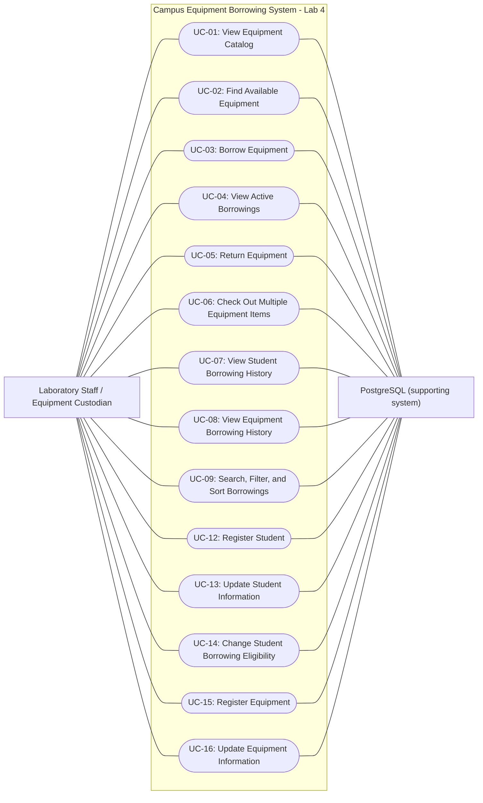

# Lab 4 use-case diagram

The diagram shows the fourteen required user goals inside the Campus Equipment Borrowing System boundary. Associations are not workflow ordering. PostgreSQL is the supporting system for every case. Internal validation is intentionally not a separate use case; no include/extend relationships are required.

Mermaid supplies a GitHub-renderable use-case-style view. The companion [PlantUML source](use-case-diagram.puml) uses native actor/usecase notation for export in a PlantUML renderer. Both describe the same boundary, fourteen goals and associations. See the [catalog](use-case-catalog.md) for deferred/future classifications and the [suite](use-case-suite.md) for behavior.
