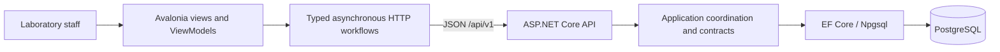

# Lab 5 architecture and continuity

## Runtime boundary

Two processes run independently. API needs private PostgreSQL configuration; Desktop needs only API origin. API requests work with Desktop closed. DesktopComposition.Build registers HTTP adapters for all seven screens; App uses that same factory as the real composition probe. The Desktop runtime dependency scan and actual native launch without database settings demonstrate the completed boundary.

## Project responsibilities

| Project | Responsibility |
|---|---|
| Domain | Student/equipment/borrowing invariants, identity/history and campus calendar |
| Application | Business coordination, result categories and repository/query/session/workflow abstractions |
| Infrastructure | Preserved EF model/migrations, repositories, relational queries, serializable sessions and failure classification |
| Contracts | JSON DTOs, required/protected input shape, string status enum and optional revision token |
| Api | Routes, transport validation, response/status mapping, backend DI and generated OpenAPI |
| Http | HttpClient transport and client implementations of workflow abstractions, DTO-to-presentation mapping |
| Desktop | Avalonia controls, MVVM commands, loading/selection/confirmation and HTTP-only composition |
| Tests / UiTests / tools | Existing domain/backend checks, headless/client checks and real-process HTTP/SQL/native probes |

Application/Domain remain referenced by Desktop/Http for workflow contracts and presentation snapshots. Server services are not registered in Desktop; Infrastructure/EF/Npgsql are absent from its project and runtime dependency graph. Domain reconstruction in the client does not persist data or replace authoritative server validation.

## API and contracts

StudentEndpoints, EquipmentEndpoints, BorrowingEndpoints and QueryAndCheckoutEndpoints expose API-01-16. JSON uses camelCase, IDs returned by the server and DateOnly YYYY-MM-DD calendar values. Lists return arrays, including empty arrays. Missing subjects are 404. Invalid JSON/fields/query values are 400; duplicate/business/stale conflicts are 409; server/database failures are safe 500. Unreachable server means no response, not HTTP 500.

Machine-readable OpenAPI is generated at /openapi/v1.json; the captured file is openapi-current.json. API-14 publishes allowed query values/defaults and stable ID tie ordering. Location headers identify new student/equipment/single-loan GET routes. Required JSON inputs reject unknown/protected fields.

API-05/06/09 optionally accept X-Expected-Revision. Desktop hashes the selected DTO fields; API compares against its fetched state, then the serializable service compares the same snapshot within the transaction. This closes the precheck-to-update gap. Callers omitting this optional extension retain the supplied base JSON contract.

## Persistence, lifetime and atomicity

API registers IDbContextFactory and repository/query/session factories; contexts are short lived. Each write workflow coordinates repositories through one serializable transaction. Checkout validates every item before writes, then updates availability and inserts loans within that transaction. Constraints enforce canonical identifier uniqueness, foreign keys, valid dates/status and one active loan per item. No automatic write replay is configured.

Existing InitialPostgres migration, frozen model, table keys and relationships remain unchanged; Lab 5 needs no new database schema. See [preserved schema/ERD](../lab4/architecture-and-schema.md). Returned records stay stored and linked. Student/equipment descriptive edits preserve internal identity/history; eligibility changes do not cancel existing loans or prevent return.

The server uses Asia/Manila checkout/return dates. Acceptance data shifts the reference's historical/future offsets from the recorded actual campus date. Tests use newly created disposable databases and reset each required subcase, not the Lab 4 demo.

## Responsiveness, synchronization and failures

HttpClient requests and JSON reads are awaited, with finite timeout and cancellation tokens. Histories/search retain latest-result guards so delayed requests cannot overwrite new criteria/subjects. Success/conflict refreshes relevant lists; navigation reloads other views. Return requires explicit confirmation; loading/unknown states disable conflicting writes.

Known rejection displays its reason. No response and received safe 500 have distinct feedback. Lost/incomplete mutation responses and explicit unknown commit feedback require fresh state verification before staff decide; no automatic mutation retry or redirect replay is installed. A known rollback is supported by fresh SQL state, never by an HTTP status alone.

## Actual architecture evidence

- [Session 8](session8-evidence.md): full composition, all real HTTP ViewModels, dependency scan and actual native API catalog without DB settings.
- [Session 9](session9-evidence.md): stopped API versus invalid server DB, same-client Retry, safe native feedback and preserved state.
- [CI summary](session9-ci-summary.json) and [retained raw CI artifact](evidence/ci-43710719990.zip): 99 tests, five process stages, seven HTTP scenarios.
- [Baseline record](baseline.md): authentic Lab 4 package provenance and refactoring continuity.

Full rendered staff sequence for T07 remains pending. These records do not claim a live lost-commit-acknowledgment experiment or complete manual accessibility review.
