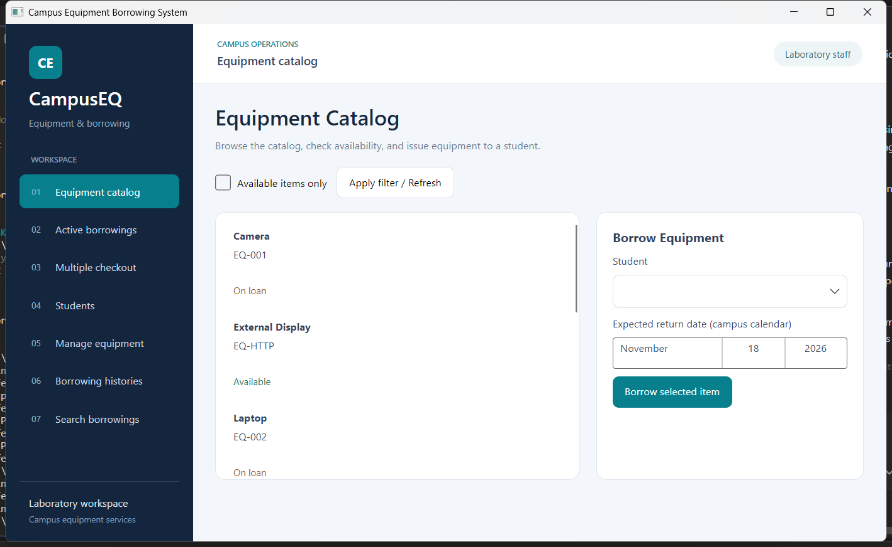

# Session 8 - HTTP-only Desktop boundary and retrieval

Date: 2026-11-15. Implementation commit: 9779dab. Histories/search now use HTTP; Desktop no longer references Infrastructure, EF Core or Npgsql. Its only application-data boundary is the API. Shared Application/Domain types remain for workflow contracts and presentation snapshots, without persistence in client composition.

## Delivered

HttpHistoryWorkflow loads Student/Equipment subjects and related histories through API-01/02/03/07/15/16. Empty history remains a successful empty array; missing subjects remain a distinct failure. Returned rows are validated for the selected subject and related display fields before mapping. HttpBorrowingSearch encodes search criteria, status, date field and direction for API-14. Clear restores defaults. Existing cancellation/latest-result gates remain in the ViewModels.

DesktopComposition.Build is used by both the actual App and the verification probe. Every workflow registration is an HTTP adapter; startup performs API catalog reads rather than DB migration/seed. Removed Infrastructure project reference and EF Design package. A clean/restore/build and runtime dependency scan confirm no EF Core/Npgsql/Infrastructure libraries in Desktop deps.json, not merely unused usings.

## Observed evidence

| Check | Result |
|---|---|
| Full solution Release build | Zero warnings/errors after correcting two nullable-flow warnings |
| Existing backend tests with PostgreSQL | 76 passed, zero failures/skips |
| UI/client tests | 23 passed, zero failures/skips |
| Full-composition real HTTP probe | 65 completed captured exchanges |
| Outer read/restart/500/recovery checks | 4 exchanges |
| Total captured exchanges | 69; canceled/in-flight/native-window reads are not counted as probe-completed exchanges |
| Native Desktop without DB setting | Correct main window opened, responding, API-backed catalog visibly populated |
| Desktop runtime dependencies | No EF Core, Npgsql or Infrastructure |

Database: `equipment_borrowing_verify_lab5_1115_193034`, newly created, campus date 2026-11-15. The probe and actual Desktop child receive API origin without PostgreSQL connection/PG credentials. No saved user configuration or existing Lab 4/development database was changed.

The real probe resolves MainWindowViewModel and all seven screen ViewModels through the same composition as App. It repeats management, independent-update/stale-header, issue/return and multi/limit/stale-item cases, then verifies student and equipment histories, known-empty versus missing subjects, Active combined search, tied-date ID order, empty results and Clear restoring seven rows. Initial four loans remain identical; final grouped state retains one returned and two active new loans. API restart and scoped DB recovery preserve state. These are grouped SQL checks around the whole probe, not per-click SQL screenshots.

[Actual wire/grouped state and dependency evidence](session8-client-evidence.json). Native window capture inspected after creation:



The harness closes its actual Desktop/API/probe processes after verification. This catalog screenshot and full real ViewModel exercise are not a recording of every staff click or pixel/accessibility review.

## New diagnostic tests and corrections

Six cases extend the previous seventeen: a late HTTP search response cannot overwrite newer criteria; empty/missing/mixed-subject history responses (three cases); delayed prior history cannot mix into the latest selected subject; full Desktop composition initializes through HTTP with no persistence assembly reference. Existing headless binding/layout cases remain. Cancellation tokens reach HttpClient; stale completion gates prevent outdated result/error rendering.

Corrections: two nullable dereference warnings were fixed at proven-success response accesses, followed by a clean final build/test. The native capture helper was separated from an initially invalid nested shell string before the actual native verification ran; final helper/window capture succeeded. No assertion failed in the final real probe. No lost-commit-acknowledgment experiment is claimed.

Upstream main advanced to f30f2a0 (Session 7 PR merge) and the remote working branch was deleted. Fast-forwarded local history to that authentic merge, then recreated/pushed the same branch with Session 8 work; no forced push/history rewrite.

## Current setup

API owns private database configuration and preserved migrations. Desktop needs only EQUIPMENT_BORROWING_API_BASE_URL, default http://127.0.0.1:5085/. Start/migrate/prepare the API separately; the Desktop neither creates/seeds a database nor reads a database connection setting. See the current root README for the two-terminal setup. Lab 4-only setup/scripts apply to its authentic submitted checkout.

Reproduce this controlled execution with the private matching NEW verification connection and PG variables from Session 2, then:

```powershell
python tools/verify-student-api.py --resource client-all --database equipment_borrowing_verify_lab5_unique_client --output docs/lab5/session8-client-evidence.json
python tools/verify-api-foundation.py --openapi-output docs/lab5/openapi-current.json
```

Native-window/screenshot checks use Windows and the included capture-desktop-window.ps1 helper. The process-only script setting does not change persistent execution policy. API/read/checkout scenarios remain independently runnable as documented.

## Acceptance status

T01-T06 retain their passing recorded API executions. T07 boundary/real HTTP ViewModel/independent-refresh checks are now complete, with native catalog evidence; full rendered staff walkthrough remains pending rather than falsely marked done. T08 still needs consolidated no-response versus received-server-failure and actual UI recovery/restart evidence in Session 9. Final report/tag remains Session 10.
