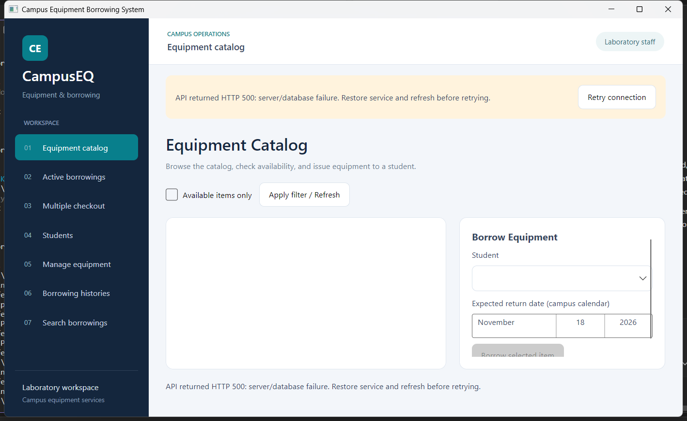
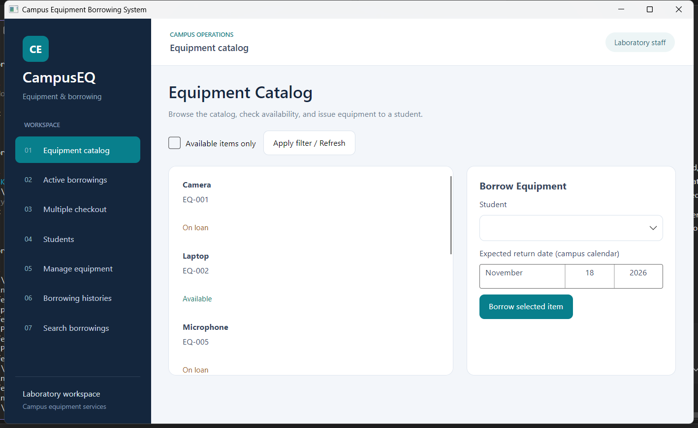

# Session 9 - integrated acceptance and recovery diagnostics

Date: 2026-11-15. Verification/CI foundation 3a12519; same-client retry refinement dc1e541. Production application code is unchanged from Session 8; this session extends real diagnostics and continuous execution.

## Actual local T08 sequence

Fresh disposable dataset: `equipment_borrowing_verify_lab5_1115_194626`. Observed UTC: 2026-11-15T11:47:17.226405+00:00; campus date 2026-11-15. A synthetic Recovery Control student was committed before failures. Independent psql snapshots capture relevant state before/after each diagnostic phase; no existing development/demo database was altered.

| Stage | Independent HTTP / client observation | Actual Desktop feedback | Saved state |
|---|---|---|---|
| API stopped | No HTTP response; status null; one deliberate client mutation reports Unknown with no replay | Clear no-response message, window responds and writes disabled | Identical to previously committed state |
| API running with DB port deliberately invalid | GET/POST receive safe 500; client distinguishes server failure; failed mutation classified Failed | HTTP 500 server/database message, no exception/credential detail | Both deliberately failed creates add nothing |
| Correct API connection restored | GET 200; same client composition invokes RetryStartupCommand and clears old feedback | Catalog loads again in a responsive native window | Original rows and Recovery Control survive API restarts |

The diagnostic client stays alive across all three phases; it does not restart to recover. Native screenshots are separate actual Desktop launches to capture each visible condition. Those windows and the API/probe processes are closed by the harness afterward. An offline mutation is conservatively unknown even though this controlled test stopped the server before sending; it is not presented as a real lost-acknowledgment experiment.

[Actual requests/statuses, same-client UI messages and fresh SQL](session9-recovery-evidence.json). Twenty-three captured HTTP exchanges/attempts passed. Dependency scan continues to show no EF Core/Npgsql/Infrastructure in Desktop.






The three native images were inspected. They show failure categories and healthy catalog, not a complete recorded staff walkthrough of every use case.

## Continuous verification

The existing workflow now runs on main, lab4/postgresql-workflows and lab5/api-integration. It builds all projects, runs backend/headless/client tests, keeps the five separate-process persistence checks, exports/validates OpenAPI, and runs reads/students/equipment/borrowings/checkout/client-all/recovery against newly created datasets. No particular testing framework was added for the acceptance harness.

Linux execution passes --no-native: native Windows capture is explicitly Not run there, while real HTTP ViewModel/composition checks and Desktop runtime dependency validation still run. Local native screenshots provide the complementary Windows evidence. CI-specific generated credentials are not the user's local credentials.

First complete run: [43710314250](https://github.com/Khey3m/EquipmentBorrowing/actions/runs/43710314250), commit 3a1251982175d27716e4b7aa26467067277422ba. Observed full build zero warnings/errors, 76 backend and 23 UI/client passes (99 total, zero skips), five process stages passed, all seven HTTP scenarios passed. Captured scenario counts: reads 57, students 43, equipment 35, borrowings 37, checkout 57, client-all 75, recovery 23 (327 exchanges/attempts; intentional errors/cancellation are expected assertions).

Final refinement run: [43710719990](https://github.com/Khey3m/EquipmentBorrowing/actions/runs/43710719990), commit dc1e54186f35600bc8cad15ed8ec6897ccdbb167, succeeded. Zero-warning full build, 99 tests with zero failures/skips, all five persistence stages and seven scenarios passed again (327 captured exchanges/attempts). The recovery scenario uses the same client process/composition across all phases. Artifact campuseq-test-results, ID 14160616423, 65,983 bytes. [Durable observed summary](session9-ci-summary.json).

TRX, generated OpenAPI and actual HTTP/fresh-state JSON are retained in the campuseq-test-results workflow artifact. Artifact retention is finite; preserve evidence needed for submission. Local artifacts from earlier sessions remain exact historical executions rather than being relabeled as this CI revision.

## Diagnosis, correction and retest

Initial local recovery and the first full CI run passed. Review identified an evidence limitation: separate diagnostic processes demonstrate recovery after restart but do not prove retry in one surviving client. Refined the probe into a line-oriented diagnostic session that reuses the same root Desktop composition across server transitions and invokes the actual Retry command. Retest locally passed all three conditions, failed-write/no-replay and saved-state checks. This was a verification-strength correction, not a production bug fix.

No observed production assertion failure in this session. Full manual staff interaction/accessibility review is still unperformed. T08 is Pass for the specified controlled API/client recovery and native feedback execution; T07 remains Partial solely for the complete rendered staff sequence beyond automated ViewModels, headless controls and native catalog evidence. T01-T06 pass again in CI against controlled reset datasets. No lab5-submitted tag is created here.

## Reproduction

Configure private PG variables and LAB5_STUDENT_VERIFY_CONNECTION for a NEW matching verification database, as documented previously, then:

```powershell
dotnet build EquipmentBorrowing.slnx --configuration Release
python tools/verify-student-api.py --resource recovery --database equipment_borrowing_verify_lab5_unique_recovery --output docs/lab5/new-recovery-evidence.json
```

Windows performs native screenshots by default; use --no-native on Linux. No shared PostgreSQL service interruption is needed: stop only the harness API, change only its process-specific connection to an invalid port, then restore it. The existing safe after-insert rollback test remains in checkout mode. Manual UI checks should use the same API origin and disposable server dataset; Desktop needs no database setting.
